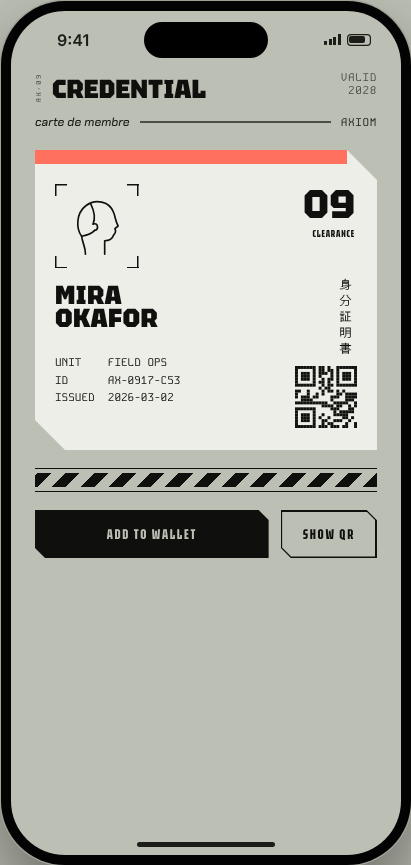

# Shingō 信号

*Shingō* is Japanese for "signal". It's an industrial interface system for iOS and the web. Interfaces are **printed** on a striped ground in hard, chamfered type: 45° cuts, hazard bars, chevrons, barcodes, seven-segment readouts, stencil serials and mono telemetry, with one coral signal per screen. English leads, with Japanese and French woven in sparingly. Every screen ships in light and dark.


Open `dist/index.html` in a browser for the full gallery: key art, 20 iPhone screens, widgets, components, 20 instruments, language rules and the origins. Use the switch in the corner to flip modes.

## Art direction

The look is sci-fi industrial, after a trilingual technical print, in the sage, ink and coral palette of a sage-and-coral poster.

1. **Print on the ground.** Content prints straight onto the stripes. Filled plates are only for things you press or carry: keys, cards, badges.
2. **One angle.** Every diagonal is 45°: corner cuts, hazard stripes, chevrons and the stripe field. Cuts sit on the top-right and bottom-left axis at 6, 12 or 24 pt. Nothing is rounded except radar rings.
3. **One grammar.** Utility screens go masthead, then one hero, then a hazard bar, then the body. The masthead holds a vertical micro-code, a 26 pt title, exactly one tag and a span rule (`08:14 ────── LIS-04`). Poster screens (launch, onboarding, lock screen, empty state) compose freely.
4. **Hard type.** Tektur Black for wordmarks (44 / 26 / 15 only), with letter corners cut like the system's 45° cuts. Tektur Condensed caps for labels, Tektur for body text, Kode Mono for telemetry, Big Shoulders Stencil for serials and stamps, and DotGothic16 for kanji. Big numbers are seven-segment readouts.
5. **One signal.** Coral marks one block or one primary action per screen, plus small states like unread and the active tab.
6. **Tag and aside.** Japanese goes in the masthead tag or a seal. French goes in the span rule. Each appears once at most. All three languages stack only once per app, on the lock screen.

7. **Instruments.** Twenty parts extrapolated from the motifs, each with a job: seven-segment readout, cell meter, ruler slider, chevron steps, index tabs, caution tag, rubber stamp, ticket stub, keycap, rocker switch, data plate, print marks and colour bar, telemetry ticker, boot log, callout, blueprint grid, oscilloscope, status lamps and stencil serials.

| dashboard | interval timer | transfer | device |
|---|---|---|---|
|  |  |  |  |


## Light and dark

| | ground (striped) | print | plates | signal |
|---|---|---|---|---|
| **Dark** | ink `#0b0b0a` | bone `#dcdfd5` | sage `#c9ccc2` | coral `#ff715e` |
| **Light** | sage `#bcbfb4` | ink `#0f100d` | paper `#eceee7` (never white) | coral `#ff715e` |

Use role tokens, never raw hex. Things printed on the ground use `--ground-*`: `--ground-hi` is the print and `--ground-dim` is secondary print. Things on plates use `--sage-*` and `--ink`. Force a mode on any web subtree with `.mode-light` or `.mode-dark`. On iOS, every `SG` colour is dynamic and follows the system appearance or `.preferredColorScheme`.

| dark | light |
|---|---|
|  |  |
|  |  |

## What's here

```
tokens/tokens.json            colours (both modes), type, geometry, screen grammar, rules
tokens/lexicon.json           EN / 日本語 / FR phrase list with readings
web/shingo.css                tokens + components + screen grammar (.u-*)
web/gallery.src.html          gallery source
web/partials/languages.html   the language section
tools/screens.py              regenerates the gallery screens from the grammar
tools/build.py                glyphs, key art, posters, exports; builds dist/
tools/screenshot.js           renders every screen in both modes (preinstalled Playwright)
dist/index.html               the built, self-contained gallery
assets/svg/*.svg              glyphs (multi-colour ones as -dark/-light pairs), origins posters
ios/                          Swift package "ShingoKit" (iOS 17+), all colours dynamic
  Sources/ShingoKit/SGTheme.swift       SG colour tokens, SGFont, font registration
  Sources/ShingoKit/SGShapes.swift      SGHardX, DiamondMark, ChamferRect, TagCut, Brackets, UnitPolygon, SignalBars
  Sources/ShingoKit/SGTextures.swift    StripeField, Barcode, Spectrum, Scope
  Sources/ShingoKit/SGComponents.swift  SGBar, SGButtonStyle, SGToggleStyle, SGSegmented, SGChip, SGSlot, SGGroupLabel, SGTabBar
  Sources/ShingoKit/SGScreen.swift      SGUtilityScreen, SGCode: the screen grammar
  Sources/ShingoKit/SGInstruments.swift  SGSegDisplay, SGCellMeter, SGRuler, SGSteps, SGIndexTabs, SGCaution, SGStamp, SGTicket, SGKeycapStyle, SGRockerStyle, SGDataPlate, SGSpecRow, SGMatrixCode, .printMarks(), SGColorBar, SGTicker, SGBootLog, SGLamps, SGBlueprint, SGCallout, SGWave
  Sources/ShingoKit/SGLanguage.swift    VerticalText, Hanko, HazardBar, ChevronStack, HeadProfile, YearSpan, ManifestoExample
  Sources/ShingoKit/Examples/           LaunchExample, DashboardExample, IntervalExample with light/dark #Previews
  Sources/ShingoKit/Resources/Fonts/    Tektur, Kode Mono, Big Shoulders Stencil, Chakra Petch Italic, DotGothic16 (SIL OFL)
docs/                         screenshots of every screen in docs/dark and docs/light
```

## Build the gallery

```bash
python3 tools/screens.py
```

```bash
python3 tools/build.py
```

```bash
node tools/screenshot.js docs
```

## Use in an iOS app

1. In Xcode, go to File › Add Package Dependencies › Add Local… and pick the `ios/` folder.
2. Register the fonts once at launch:
   ```swift
   import ShingoKit
   @main struct MyApp: App {
       init() { SGFont.register() }
       var body: some Scene { WindowGroup { DashboardExample() } }
   }
   ```
3. Build screens on the grammar:
   ```swift
   SGUtilityScreen("Protected", span: (Text("since 08:14"), Text("lis-04")), tag: .japanese("保護中")) {
       SGBar(height: 100, bleed: .leading, progress: 0.82).frame(width: 270)
   } content: {
       Toggle("Kill switch", isOn: $on).toggleStyle(SGToggleStyle())
       Button("Disconnect") {}.buttonStyle(SGButtonStyle(.print))
   }
   ```
4. For static art, drag `assets/svg/*.svg` into an asset catalog and tick **Preserve Vector Data**. Single-colour glyphs render as template images, so tint them in code. For multi-colour ones (`scope`, `topo`, `radar-fan`, `poster`), set Appearances to Any/Dark and drop the `-light` file into Any and the `-dark` file into Dark.

> The Swift sources were written against the iOS 17 SwiftUI API but have **not been compiled yet**. The build environment had no Swift toolchain. Expect a few small fixes on the first Xcode build.

## Web → SwiftUI map

| Web | SwiftUI | Notes |
|---|---|---|
| `.tex`, `.facet` | `StripeField(facets:)` | 45° stripes, 6 pt period |
| `.u`, `.u-hd`, `.u-hero`, `.hazard`, `.u-body` | `SGUtilityScreen` | the screen grammar |
| `.bar` (+ `--bleed-r`) | `SGBar(height:bleed:progress:)` | band 16%, cut 42% of height |
| `#g-x-line` / `#g-x-solid` | `SGHardX()` stroke / fill | square-cut ends |
| `#g-mark` | `DiamondMark()` with `eoFill` | |
| `.chamfer`, `.cut` | `.chamferFrame()`, `ChamferRect` | cuts 6 / 12 / 24 |
| `.brackets` | `.brackets()`, `Brackets` | HUD corners |
| `.slab-cut` | `TagCut` | the coral tag slab |
| `.hazard` | `HazardBar` | |
| `.btn--*` | `SGButtonStyle(.print/.signal/.plate/.ink/.ghost)` | 48 pt, cut 10 |
| `.tgl` | `SGToggleStyle()` | |
| `.seg` | `SGSegmented` | |
| `.slot`, `.yearspan`, `.barcode` | `SGSlot`, `YearSpan`, `Barcode` | |
| `#g-spectrum`, `#g-scope` | `Spectrum`, `Scope` | |
| `seg7()`, `.cells`, `.ruler` | `SGSegDisplay`, `SGCellMeter`, `SGRuler` | readouts and levels |
| `.steps`, `.itabs`, `.caution`, `.stamp` | `SGSteps`, `SGIndexTabs`, `SGCaution`, `SGStamp` | |
| `.ticket`, `.keycap`, `.rocker`, `.dataplate` | `SGTicket`, `SGKeycapStyle`, `SGRockerStyle`, `SGDataPlate` | |
| `.marks`, `.colorbar`, `.ticker`, `.bootlog`, `.lamps` | `.printMarks()`, `SGColorBar`, `SGTicker`, `SGBootLog`, `SGLamps` | |
| `.callout`, `.blueprint`, `#g-wave`, `#g-matrix` | `SGCallout`, `SGBlueprint`, `SGWave`, `SGMatrixCode` | |

## Three languages

- **English** runs the interface: every action, label and number.
- **日本語** adds texture: vertical captions (`.sg-jp-v` / `VerticalText`), hanko seals (`.hanko` / `Hanko`) and display kanji. At most one per screen, and never the only label on a control.
- **Français** is the aside: italic notes in the span rule, dates, pull quotes and fine print (`.sg-fr` / `.sgFR()`). At most one per screen.

Every phrase, with its Japanese reading, is in `tokens/lexicon.json`. These are drafts: have native speakers check them before release.

## Origins

Shingō started from two references. A sage and coral poster gave it the palette, the striped ground, the nested forms and right-aligned telemetry. A trilingual technical print gave it the voice: wide industrial type, hazard bars, chevrons, barcodes, the line-art head, and English with Japanese and French. The system now leans toward the second. The poster is still rebuilt in the gallery's Origins section (`assets/svg/poster-dark.svg`, `poster-light.svg`).

It was first measured against `nexu-io/open-design`'s brutalist skill, a text-only prompt with no assets. Its accent was hazard red rather than coral, and it allowed one background per screen, while the poster layers sage on ink. Shingō was built from scratch instead.

## Fonts

Tektur, Kode Mono, Big Shoulders Stencil Display, Chakra Petch and DotGothic16 are all licensed under the SIL Open Font License 1.1. You may bundle them in an app. DotGothic16 is the largest at about 1.8 MB, because it covers the full Japanese character set.
