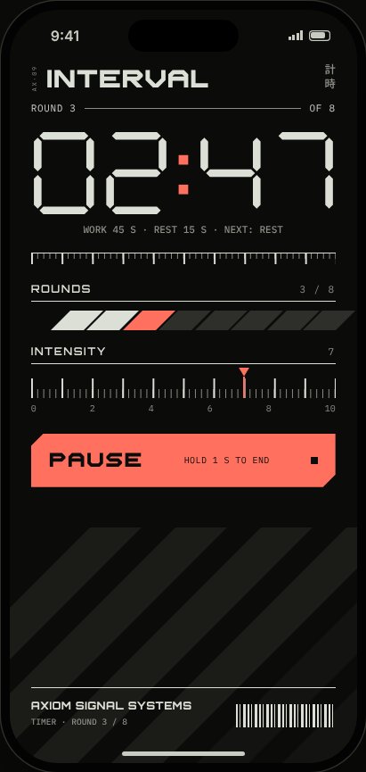
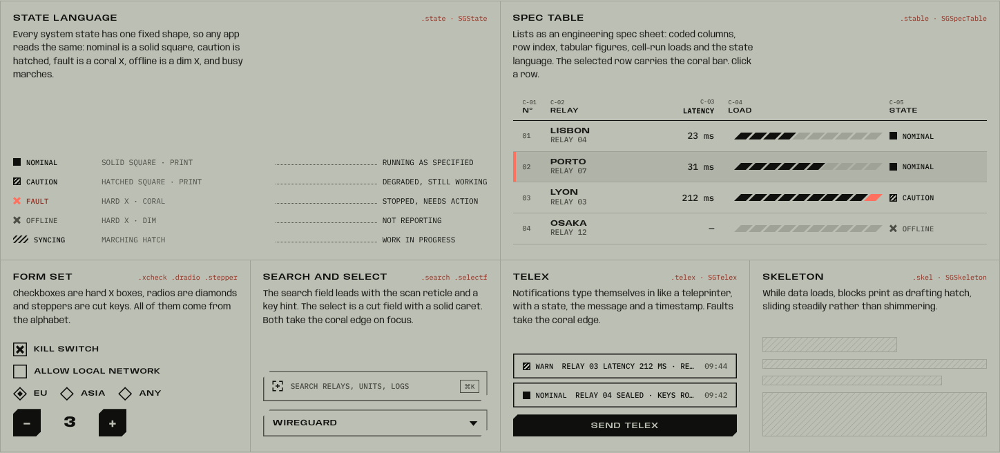
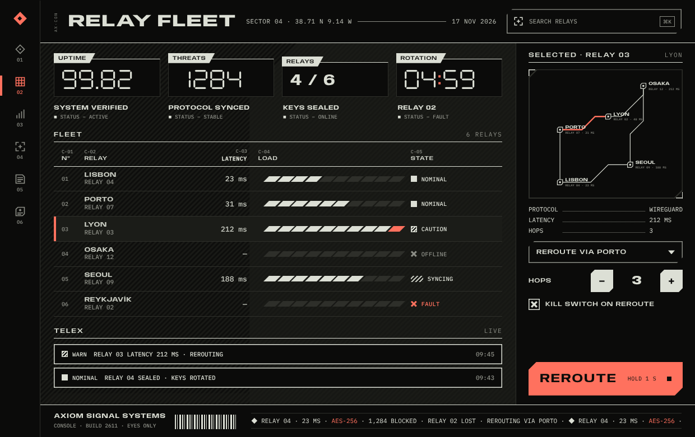
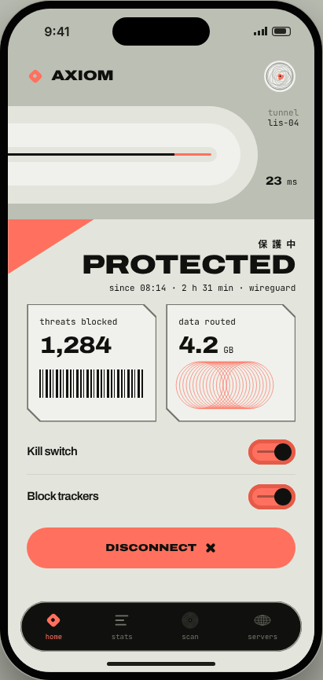

# Shingō 信号

*Shingō* is Japanese for "signal". It's an industrial interface system for iOS and the web. Interfaces are **printed** on a striped ground, like a two-ink screen print: wide hard type, one 45° diagonal, hazard stripes, chevrons, seven-segment readouts, stencil serials and mono telemetry, with one coral signal per screen. English leads, with Japanese and French as accents. Every screen ships in light and dark.


Open `dist/index.html` in a browser for the full gallery: key art, the shape alphabet, content motifs, backdrops, 26 iPhone screens, widgets, components, instruments, the poster series, motion studies, patterns for any app, a desktop console and language rules. Use the switch in the corner to flip modes.

## Art direction

One spec. Everything in the repo follows it, and anything new must too.

**Color**
1. **Two inks.** Print on ground, nothing else. Solid shapes (keys, cards, badges, tickets, bars, plates) are print ink with the text knocked out. There is no third tone.
2. **One signal.** Coral is the only extra ink: one block or one primary action per screen, plus the latest or active state. Switches turn on in print. Coral used as text takes `--signal-text`, a deeper coral on sage so small type stays legible. Inside a print plate (tickets, data plates, `[data-plate]`) the ground flips, so it takes `--signal-plate` instead; those plates set it for you. Coral never draws guides, dashed outlines, frames or annotations: construction marks and notes print in the dim ink (`--ground-dim`), and warnings are framed in print with a hazard spine.

**Shape**

3. **One angle, one direction.** Every diagonal rises left to right at 45°. Corner cuts sit top-left and bottom-right at 6, 12 or 24 pt. Nothing is tilted, textured, shadowed or rounded; device chrome is the only exception.
4. **The alphabet.** Twelve primitives make everything: cut plate, tag, nested bar (a solid bar with a slot), slash, hazard, notch frame, hard X, diamond, chevrons, brackets, cell run and wedge.
5. **Content motifs.** Where a screen has a subject, its shape comes from that subject, drawn by the same rules: lock tumblers, postage stamp, DIP switches, wind barbs, packet flow, cut fingerprint, compass rose, level meters and security microtext.
6. **Icons.** One family on a 24-unit grid with 2-unit strokes, square caps and miter joins.

**Type**

7. **Wide, short, hard.** Anybody at three widths: display 40+ (extra-expanded 800), titles 28 (expanded 800) and inline 14 (expanded 700). Labels are wide caps. Body text is Anybody, telemetry IBM Plex Mono, serials Saira Stencil One and kanji BIZ UDGothic (Hiragino Sans on iOS). Big numbers are seven-segment readouts. Never condensed, never rounded.

**Layout**

8. **Two tiers.** Poster screens (launch, onboarding, lock screen, empty state, relay city, live activity) compose freely. Every other screen follows the grammar: masthead (micro-code, title, one tag, span rule) → one hero → divider → body → imprint footer (rule, wide-caps line, mono reference, barcode).
9. **Dividers by kind.** Hazard for system and safety screens, a tick ruler for data, a slash run for money and content.
10. **One backdrop per screen: a quiet monument.** Behind the content sits one oversized hard mass that bleeds off the edges: a **monolith**. It prints only in the stripe's own tone: the mass is the stripe filled in solid (ground-2), secondary parts in its half-tone, openings are real holes that show the stripes, and small cuts knock out to the ground. It should be felt before it is seen. No outlines, no ground-3, no layering beyond the mass and its cuts. Chosen by subject from 22: monolith, bulkhead, giant X, chevrons, zones, diamond, girder, aperture, segment, massing, ramp, pylon, dam, hangar, switchback, tag, nested bar, cells, brackets, silo, shutter and notch plate. The finer line compositions (tunnel, circuit traces, relays and the rest) survive only as heroes and insets, such as the dashboard tunnel and the briefing's traces, never as a screen backdrop. The same monoliths sit behind the console and the starter page.

**Imagery and motion**

11. **No pictorial scenes.** There is no photography and no illustrated or generated cities. Imagery comes from the shape system itself: backdrops, motifs and diagrams such as the relay network.
12. **Slides glide, states step.** Nothing is ever eased. Anything that travels sideways (tickers, marching hazard and hatch, the wipe band) moves continuously at an even, linear speed. Changes of state (blinks, cell fills, pulses, the radar sweep, text decode) step. Everything stays still when reduced motion is on.
13. **Live behaviour.** The interface behaves like a machine:
    - Information decodes from glyph noise. Each character locks in at its own random moment, the flicker is irregular, and no two decodes take the same time. Noise keeps each character's class (digits flicker through digits, capitals through hard capitals, kanji through kanji); punctuation and spaces never scramble, so the structure of a line holds while it resolves.
    - Decoding has three triggers. **Arrival:** a screen or section decodes top to bottom in three weights: titles (0.32–0.72 s), then labels, codes, column heads and buttons (0.16–0.38 s), then data such as span rules, spec values, table figures, states and imprint lines (0.2–0.52 s), staggered 18 ms apart. **Change:** a new value decodes (stepper, selected row, telex timestamp, HUD callout). **Touch:** buttons, keys, tabs and chips re-decode their label under the pointer (0.12–0.26 s).
    - Paragraphs, inputs, tickers, telex messages (they type instead) and seven-segment readouts never decode.
    - Seven-segment readouts re-render in place: timers count, counters climb, coordinates drift.
    - Views change behind a hazard band that slides across on the diagonal at an even speed.
    - A HUD reticle snaps coral brackets and a callout to data under the pointer (on iOS, press and hold).
    - Tickers, marching hazard bars, busy states and loading hatch slide smoothly and loop without a seam.

    On iOS each shape has a feel: a hard tick for switches and tabs, a double tick for keycaps, a heavy throw for the rocker, rising steps for cell meters, an error pattern for alerts and a success pattern for sealed. Web: `web/shingo-live.js`. iOS: `SGLive.swift` (`SGHaptics`, `SGScrambleText`, `SGLiveCountdown`, `.sgHazardWipe`, `.sgHUD`).

**Language**

14. **English runs the interface.** Japanese (a vertical tag or a seal) and French (the span rule or fine print) appear at most once each per screen. All three stack only once per app, on the lock screen.

**Patterns**

15. **States have shapes.** Every system state has one fixed mark, in every app: nominal is a solid square, caution is hatched, fault is a coral X, offline is a dim X and syncing is a marching hatch. Never signal state by colour alone.
16. **Data is a spec sheet.** Lists are spec tables: coded columns (C-01…), a row index, tabular figures and the coral bar on the selected row. Form controls come from the alphabet: checkboxes are hard X boxes, radios are diamonds and steppers are cut keys.
17. **The machine reports.** Notifications type in like a telex (state, message, timestamp; faults take a coral edge). Loading prints as drafting hatch that slides steadily, never a shimmer or a spinner.
18. **Beyond the phone.** Larger screens keep the grammar and add a rail: masthead across the top, readouts as the hero, the spec table as the body, a side panel for the selection, and the imprint plus ticker as the footer (see the Console section of the gallery).

| dashboard | interval timer | transfer | device |
|---|---|---|---|
|  |  |  |  |






## Light and dark

| | ground (striped) | print | plates | signal |
|---|---|---|---|---|
| **Dark** | ink `#0b0b0a` | bone `#dcdfd5` | bone, text knocked out | coral `#ff715e` (text `#ff715e`) |
| **Light** | sage `#bcbfb4` | ink `#0f100d` | ink, text knocked out | coral `#ff715e` (text `#8f2b1c`) |

Use role tokens, never raw hex. Things printed on the ground use `--ground-*`: `--ground-hi` is the print and `--ground-dim` is secondary print. Things on plates use `--sage-*` and `--ink`. Force a mode on any web subtree with `.mode-light` or `.mode-dark`. On iOS, every `SG` colour is dynamic and follows the system appearance or `.preferredColorScheme`.

| dark | light |
|---|---|
|  |  |
|  |  |

## What's here

```
tokens/tokens.json            colours (both modes), type, geometry, screen grammar, rules
tokens/lexicon.json           EN / 日本語 / FR phrase list with readings
web/shingo.css                tokens + components + screen grammar (.u-*)
web/shingo-live.js            live layer: scramble, live readouts, hazard wipe, HUD reticle, telex, steppers, table rows
templates/starter.src.html    a complete app page built only from the kit (source of dist/starter.html)
web/gallery.src.html          gallery source
web/partials/languages.html   the language section
tools/screens.py              regenerates the gallery screens from the grammar
tools/monoliths.py            the monolith backdrops as polygon data (web symbols and SwiftUI are generated from it)
tools/build.py                glyphs, motifs, backdrops, key art, posters; builds dist/
tools/check_tokens.py         fails the build if tokens.json, shingo.css and SGTheme.swift disagree
tools/screenshot.js           renders every screen in both modes (preinstalled Playwright)
dist/index.html               the built, self-contained gallery
dist/shingo.css               the kit stylesheet for other apps (fonts imported)
dist/shingo-live.js           the live layer, standalone
dist/shingo-sprite.svg        every glyph, icon, motif and backdrop as <symbol id="g-…">
dist/starter.html             the starter page, built (open it next to shingo.css)
tokens/shingo.tokens.json     the colour, dimension and font tokens in W3C DTCG format (generated)
skills/shingo/SKILL.md        instructions for an AI agent applying Shingō to a new app
CLAUDE.md                     repo conventions for agents working in this repo
assets/svg/*.svg              glyphs and icons (multi-colour ones as -dark/-light pairs)
ios/                          Swift package "ShingoKit" (iOS 17+), all colours dynamic
  Sources/ShingoKit/SGTheme.swift       SG colour tokens, SGFont, font registration
  Sources/ShingoKit/SGShapes.swift      SGHardX, DiamondMark, ChamferRect, TagCut, Brackets, UnitPolygon, SignalBars
  Sources/ShingoKit/SGTextures.swift    StripeField, Barcode, Spectrum, Scope
  Sources/ShingoKit/SGComponents.swift  SGBar, SGButtonStyle, SGToggleStyle, SGSegmented, SGChip, SGSlot, SGGroupLabel, SGTabBar
  Sources/ShingoKit/SGBackdrop.swift     SGBackdrop: eleven of the line backdrops
  Sources/ShingoKit/SGMonolith.swift     SGMonolith: all 22 monoliths (generated, do not edit)
  Sources/ShingoKit/SGLive.swift        SGHaptics, SGScrambleText, SGLiveCountdown, sgHazardWipe transition, sgHUD readout
  Sources/ShingoKit/SGScreen.swift      SGUtilityScreen, SGCode: the screen grammar
  Sources/ShingoKit/SGInstruments.swift  SGSegDisplay, SGCellMeter, SGRuler, SGSteps, SGIndexTabs, SGCaution, SGStamp, SGTicket, SGKeycapStyle, SGRockerStyle, SGDataPlate, SGSpecRow, SGMatrixCode, .printMarks(), SGColorBar, SGTicker, SGBootLog, SGLamps, SGBlueprint, SGCallout, SGWave
  Sources/ShingoKit/SGPatterns.swift    SGState, SGSpecTable, SGXCheckboxStyle, SGDiamondRadio, SGStepper, SGSearchField, SGTelex, SGSkeleton
  Sources/ShingoKit/SGLanguage.swift    VerticalText, Hanko, HazardBar, ChevronStack, YearSpan, ManifestoExample
  Sources/ShingoKit/Examples/           LaunchExample, DashboardExample, IntervalExample with light/dark #Previews
  Sources/ShingoKit/Resources/Fonts/    Anybody (3 widths + italic), Saira Stencil One, IBM Plex Mono (SIL OFL)
docs/                         screenshots of every screen in docs/dark and docs/light
```

## Build the gallery

```bash
python3 tools/screens.py
```

```bash
python3 tools/build.py
```

```bash
node tools/screenshot.js docs
```

`build.py` also writes the standalone kit in `dist/`, regenerates `tokens/shingo.tokens.json` and runs the token check. `npm run build` does all of it in one go.

## Apply Shingō to another app

The repo is built to be lifted into anything. Pick the route that fits.

**A web app**

1. Copy `dist/shingo.css`, `dist/shingo-live.js` and `dist/shingo-sprite.svg` into the app. The stylesheet imports the fonts from Google Fonts; self-host them if you need to.
2. Inline the sprite once at the top of `<body>` (or fetch it and inject it), then use any glyph with `<svg><use href="#g-i-scan"/></svg>`.
3. Put `class="tex"` on the page or app root for the striped ground, and `data-sg-live` on any region that should get the live layer (decode, readouts, HUD, wipe). Phone screens use `.scr`, desktop consoles `.con`. `data-decode-view` decodes any other element when it scrolls into view, `data-decode-change` decodes a value whenever its text changes, and `data-no-decode` opts a node out.
4. Start from `dist/starter.html`: a masthead, readout hero, hazard divider, spec table, telex feed, form set and imprint, in both modes, responsive down to 390 px.
5. Script hooks: `window.shingo.telex(stack, state, message, time)`, `window.shingo.wipe(el, fn)`, `window.shingo.scramble(region)` (the arrival decode), `window.shingo.decode(el, 'title'|'label'|'data'|'touch')` and `window.shingo.decodeOnChange(el)`. States are `ok`, `warn`, `fault`, `off` and `busy`.

**Another design tool or platform**

Import `tokens/shingo.tokens.json` (W3C DTCG) into Figma Tokens/Tokens Studio, Style Dictionary or similar. `tokens/tokens.json` has the full spec beyond colour: type scale, geometry, grammar, motion and rules.

**An iOS app**

Add `ios/` as a local Swift package (see below). Every web pattern has a SwiftUI counterpart in the map.

**An AI agent**

Point the agent at `skills/shingo/SKILL.md`. It holds the rules in checklist form, the component vocabulary and the review steps.

**Make it yours**

- **Brand.** The examples use the placeholder brand AXIOM (marks `AX·09`, "Axiom signal systems"). Replace the name, the masthead codes and the imprint line. Keep the format: a short code, a wide-caps line and a mono reference.
- **Signal colour.** Coral is the one extra ink. To rebrand it, change `--coral`, `--coral-deep`, `--signal-text` and `--signal-plate` in `tokens/tokens.json`, `web/shingo.css` and `SGTheme.swift`, then run the build; the token check fails until all three agree. Keep it a single warm, saturated ink that reads on both grounds.
- **Content.** Pick a backdrop, a divider and (if the subject has one) a motif for each screen from the lists in the rules. Write English first, then add at most one Japanese and one French accent per screen from `tokens/lexicon.json`.

**Checklist for any new screen**

- [ ] Works in light and dark (`data-theme`, `.mode-light` / `.mode-dark`, or SwiftUI appearance).
- [ ] One coral block or primary action; coral text uses `--signal-text`.
- [ ] Every diagonal is "/"; cuts top-left and bottom-right; no radius, shadow, tilt or texture.
- [ ] Wide type only; big numbers are seven-segment readouts.
- [ ] Utility screens follow the grammar: masthead → hero → divider → body → imprint.
- [ ] States use the state shapes; lists are spec tables; loading is hatch.
- [ ] Slides are continuous and linear, state changes step, nothing eases, and everything stops under reduced motion.

## Use in an iOS app

1. In Xcode, go to File › Add Package Dependencies › Add Local… and pick the `ios/` folder.
2. Register the fonts once at launch:
   ```swift
   import ShingoKit
   @main struct MyApp: App {
       init() { SGFont.register() }
       var body: some Scene { WindowGroup { DashboardExample() } }
   }
   ```
3. Build screens on the grammar:
   ```swift
   SGUtilityScreen("Protected", span: (Text("since 08:14"), Text("lis-04")), tag: .japanese("保護中")) {
       SGBar(height: 100, bleed: .leading, progress: 0.82).frame(width: 270)
   } content: {
       Toggle("Kill switch", isOn: $on).toggleStyle(SGToggleStyle())
       Button("Disconnect") {}.buttonStyle(SGButtonStyle(.print))
   }
   ```
4. For static art, drag `assets/svg/*.svg` into an asset catalog and tick **Preserve Vector Data**. Single-colour glyphs render as template images, so tint them in code. For multi-colour ones (`scope`), set Appearances to Any/Dark and drop the `-light` file into Any and the `-dark` file into Dark.

> The Swift sources were written against the iOS 17 SwiftUI API but have **not been compiled yet**. The build environment had no Swift toolchain. Expect a few small fixes on the first Xcode build.

## Web → SwiftUI map

| Web | SwiftUI | Notes |
|---|---|---|
| `.tex`, `.facet` | `StripeField(facets:)` | 45° stripes, 6 pt period |
| `.sg-bg` + `#g-bg-{monolith}` | `SGMonolith(.bulkhead)` | generated from `tools/monoliths.py` |
| `.u`, `.u-hd`, `.u-hero`, `.hazard`, `.u-body` | `SGUtilityScreen` | the screen grammar |
| `.bar` (+ `--bleed-r`) | `SGBar(height:bleed:progress:)` | band 16%, cut 42% of height |
| `#g-x-line` / `#g-x-solid` | `SGHardX()` stroke / fill | square-cut ends |
| `#g-mark` | `DiamondMark()` with `eoFill` | |
| `.chamfer`, `.cut` | `.chamferFrame()`, `ChamferRect` | cuts 6 / 12 / 24 |
| `.brackets` | `.brackets()`, `Brackets` | HUD corners |
| `.slab-cut` | `TagCut` | the coral tag slab |
| `.hazard` | `HazardBar` | |
| `.btn--*` | `SGButtonStyle(.print/.signal/.plate/.ink/.ghost)` | 48 pt, cut 10 |
| `.tgl` | `SGToggleStyle()` | |
| `.seg` | `SGSegmented` | |
| `.slot`, `.yearspan`, `.barcode` | `SGSlot`, `YearSpan`, `Barcode` | |
| `#g-spectrum`, `#g-scope` | `Spectrum`, `Scope` | |
| `seg7()`, `.cells`, `.ruler` | `SGSegDisplay`, `SGCellMeter`, `SGRuler` | readouts and levels |
| `.steps`, `.itabs`, `.caution`, `.stamp` | `SGSteps`, `SGIndexTabs`, `SGCaution`, `SGStamp` | |
| `.ticket`, `.keycap`, `.rocker`, `.dataplate` | `SGTicket`, `SGKeycapStyle`, `SGRockerStyle`, `SGDataPlate` | |
| `.marks`, `.colorbar`, `.ticker`, `.bootlog`, `.lamps` | `.printMarks()`, `SGColorBar`, `SGTicker`, `SGBootLog`, `SGLamps` | |
| `.callout`, `.blueprint`, `#g-wave`, `#g-matrix` | `SGCallout`, `SGBlueprint`, `SGWave`, `SGMatrixCode` | |
| `.state--ok/warn/fault/off/busy` | `SGState(.nominal/.caution/.fault/.offline/.syncing)` | one shape per state |
| `.stable` | `SGSpecTable` | coded columns, coral bar on selection |
| `.xcheck`, `.dradio`, `.stepper` | `SGXCheckboxStyle`, `SGDiamondRadio`, `SGStepper` | the form set |
| `.search`, `.selectf` | `SGSearchField`, `Picker` in a `ChamferRect` frame | |
| `.telex`, `window.shingo.telex()` | `SGTelex` | types in; faults buzz |
| `.skel` | `SGSkeleton` | drafting hatch |
| decode (`data-decode-view`, `data-decode-change`, `data-no-decode`), `.live-*`, `.sg-wipe`, `.sg-hud` | `SGScrambleText(_:weight:delay:)`, `SGLiveCountdown`, `.sgHazardWipe`, `.sgHUD` | the live layer |

## Three languages

- **English** runs the interface: every action, label and number.
- **日本語** adds texture: vertical captions (`.sg-jp-v` / `VerticalText`), hanko seals (`.hanko` / `Hanko`) and display kanji. At most one per screen, and never the only label on a control.
- **Français** is the aside: italic notes in the span rule, dates, pull quotes and fine print (`.sg-fr` / `.sgFR()`). At most one per screen.

Every phrase, with its Japanese reading, is in `tokens/lexicon.json`. These are drafts: have native speakers check them before release.

## Origins

Shingō started from two references: a sage and coral poster (palette, striped ground, layered forms, right-aligned telemetry) and a trilingual technical print (wide industrial type, hazard bars, chevrons, barcodes, three languages). Later references added field-operations print (status matrices, redaction, ID plates) and a construction-guide poster (an exploded X, guides, city data over a photo). Earlier rounded forms from the first poster have been retired.

## SwiftUI coverage

ShingoKit covers the tokens, type, alphabet shapes, components, instruments, icons, the screen grammar, all 22 monoliths, eleven line backdrops, the live layer (scramble, countdowns, wipe, HUD, haptics) and the patterns (states, spec table, form set, search, telex, skeleton). Web-only so far: the motifs, six of the backdrops, the ops furniture, constructed type, the relay network diagram, the posters and the console layout. The Swift code hasn't been compiled yet.

## Fonts

Anybody, Saira Stencil One and IBM Plex Mono are licensed under the SIL Open Font License 1.1 (licence texts next to the fonts in `ios/Sources/ShingoKit/Resources/Fonts/OFL-*.txt`). You may bundle them in an app; keep the licence texts with them. Japanese uses Hiragino Sans, which ships with iOS, and BIZ UDGothic on the web. BIZ UDGothic isn't bundled because it's 4 MB.

## Licence

The code, tokens, artwork and docs are MIT licensed (see `LICENSE`). The bundled fonts keep their own SIL Open Font License.
