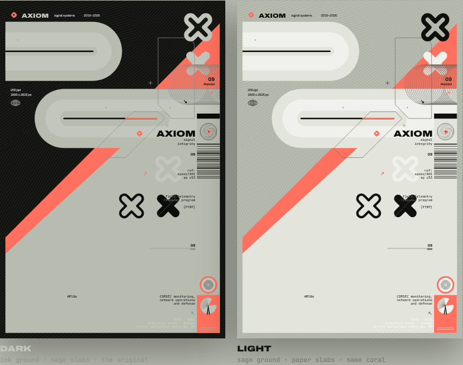
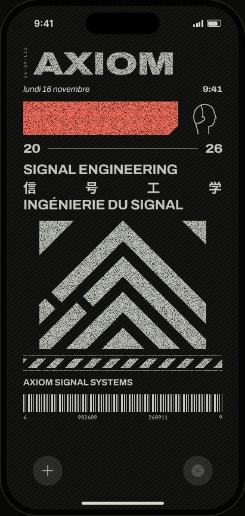
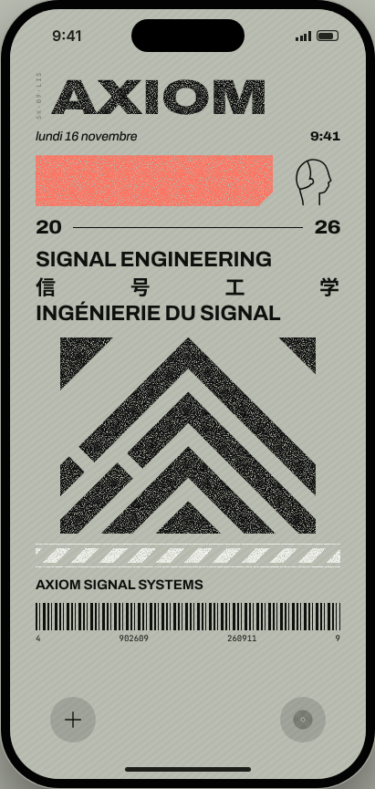

# Shingō 信号

*Shingō* is Japanese for "signal". It's an interface style for iOS and the web: sage slabs on a striped ground, one coral diagonal, nested stadium pills, rounded X marks and telemetry set in mono. English leads, with Japanese and French woven in sparingly. Every screen ships in light and dark.



Open `dist/index.html` in a browser for the full gallery: a poster study, 16 iPhone screens, widgets, components and language rules. Use the switch in the corner to flip modes.

## Light and dark

Both modes keep the same layering, so the look survives the switch:

| | ground (striped) | slabs | ink & coral |
|---|---|---|---|
| **Dark** | ink `#0c0c0a` | sage `#b8bbb0` | same |
| **Light** | sage `#bcbfb4` | paper `#e3e5dd` (never white) | same |

Use role tokens, never raw hex. Anything sitting on the striped ground uses `--ground-*` (`SG.ground*`): body text is `--on-ground`, titles and line art are `--ground-hi`. Anything on a slab uses `--sage-*` and `--ink`. Force a mode on any web subtree with `.mode-light` or `.mode-dark`. On iOS, every `SG` colour is dynamic and follows the system appearance or `.preferredColorScheme`.

| dark | light |
|---|---|
|  |  |
|  |  |

## Origins

Shingō started from two references: a sage and coral poster, and a trilingual technical print. It was first measured against `nexu-io/open-design`'s brutalist skill, which turned out not to fit:

### Why it isn't built on `open-design/brutalist-skill`

That skill (`nexu-io/open-design/skills/brutalist-skill/SKILL.md`) is a 9 KB text prompt. It has no assets, components or code, and three of its rules contradict this poster:

| Skill says | Poster does |
|---|---|
| "Absolute rejection of border-radius" | Built on stadium pills, circles and rounded X marks |
| One substrate per project, "never mix light and dark" | Sage slabs on an ink stripe ground on every screen |
| Accent `#E61919` hazard red | Accent `#ff715e` coral, on a sage `#bab9ad` palette |

It is useful for tone: mono telemetry, technical framing, barcodes and crosshairs. It can't reproduce this look, so this kit was built from scratch with measurements taken from the reference image.

## What's here

```
tokens/tokens.json            colours, type, geometry ratios, usage rules
tokens/lexicon.json           EN / 日本語 / FR phrase list with readings
web/shingo.css                light/dark tokens + components (.pill .btn .tgl .seg .chamfer .slot .barcode .tex)
web/gallery.src.html          gallery source: poster study, 16 screens, widgets, component sheet, language rules
tools/build.py                generates glyphs + poster SVG, exports assets, builds dist/
tools/screenshot.js           renders every screen to PNG with the preinstalled Playwright
dist/index.html               the built, self-contained gallery (open in a browser; light/dark switch)
assets/svg/*.svg              vector glyphs; multi-colour ones as -dark/-light pairs; poster-dark/-light.svg
ios/                          Swift package "ShingoKit" (iOS 17+), all colours dynamic
  Sources/ShingoKit/SGTheme.swift       SG dynamic colour tokens, SGFont, font registration
  Sources/ShingoKit/SGShapes.swift          RoundedX, DiamondMark, ChamferRect, UnitPolygon, Crosshair, ArrowNE
  Sources/ShingoKit/SGTextures.swift        StripeField (Canvas), Barcode, RingsCoil, RecordDisc, RadarScope
  Sources/ShingoKit/SGComponents.swift      NestedPill, SGButtonStyle, SGToggleStyle, SGSegmented, SGChip, SGRule, SGSlot, SGTabBar
  Sources/ShingoKit/SGLanguage.swift        SGFont.jp/.fr, VerticalText, Hanko, HazardBar, ChevronStack, HeadProfile, YearSpan, ManifestoExample
  Sources/ShingoKit/Examples/               LaunchExample + DashboardExample with #Previews
  Sources/ShingoKit/Resources/Fonts/        Archivo + JetBrains Mono TTFs (SIL OFL)
docs/                         screenshots of every screen
```

## Three languages

The second reference (a trilingual print) adds Japanese and French, used sparingly:

- **English** runs the interface: every action, label and number.
- **日本語** adds texture: vertical captions (`.sg-jp-v` / `VerticalText`), hanko seals (`.hanko` / `Hanko`) and outlined display kanji (`.sg-jp-outline`). At most one per screen, and never the only label on a control.
- **Français** is the aside: italic footnotes, dates, taglines and pull quotes (`.sg-fr` / `.sgFR()`). At most one per screen.
- All three are stacked **once per app**, on the manifesto lock screen (screen N, `ManifestoExample`).

Print motifs from that reference: `ChevronStack` / `#g-chevrons`, `HazardBar` / `.hazard`, `HeadProfile` / `#g-head`, `YearSpan` / `.yearspan`, the cut-corner coral slab `.slab-cut`, and a worn screen-print filter `.wear` (web only).

Every phrase, with its Japanese reading, is in `tokens/lexicon.json`. These are drafts: have native speakers check them before release.

## Build the gallery

```bash
python3 tools/build.py
```

```bash
node tools/screenshot.js docs   # writes docs/dark and docs/light
```

## Use in an iOS app

1. In Xcode, go to File › Add Package Dependencies › Add Local… and pick the `ios/` folder.
2. Register the fonts once at launch:
   ```swift
   import ShingoKit
   @main struct MyApp: App {
       init() { SGFont.register() }
       var body: some Scene { WindowGroup { DashboardExample() } }
   }
   ```
3. Build screens from the parts:
   ```swift
   ZStack {
       StripeField()
       NestedPill(height: 124, bleed: .leading, progress: 0.8)
       RoundedX().stroke(SG.groundHi, style: .init(lineWidth: 7, lineJoin: .round))
   }
   Button("Disconnect") {}.buttonStyle(SGButtonStyle(.coral))
   Toggle("Kill switch", isOn: $on).toggleStyle(SGToggleStyle())
   ```
4. For static art, drag `assets/svg/*.svg` into an asset catalog and tick **Preserve Vector Data**. Single-colour glyphs render as template images, so tint them in code. For multi-colour glyphs (`topo`, `radar-fan`, `poster`), set Appearances to Any/Dark and drop the `-light` file into Any and the `-dark` file into Dark.

> The Swift sources were written against the iOS 17 SwiftUI API but have **not been compiled yet**. The build environment had no Swift toolchain. Expect a few small fixes on the first Xcode build.

## Web → SwiftUI map

| Web | SwiftUI | Notes |
|---|---|---|
| `.tex`, `.facet` | `StripeField(angle:facets:)` | 6 pt soft stripes, facets are clipped polygons |
| `.pill` (+ `--bleed-l/r`) | `NestedPill(height:bleed:progress:)` | band 18%, core 15%, slot 3% of height |
| `#g-x-line` / `#g-x-solid` | `RoundedX()` stroke / fill | halfWidth 12.5, armLength 32 |
| `#g-mark` | `DiamondMark()` with `eoFill` | brand mark with a hole |
| `.chamfer` | `.chamferFrame()` / `ChamferRect` | cut 16 |
| `.slab`, `.band` | `UnitPolygon([...]).fill(...)` | the diagonal split |
| `.btn--*` | `SGButtonStyle(.ink/.coral/.sage/.ghost)` | 52 pt capsule |
| `.tgl` | `SGToggleStyle()` | |
| `.seg` | `SGSegmented` | |
| `.slot`, `.rule`, `.barcode` | `SGSlot`, `SGRule`, `Barcode` | |

## Fonts

Japanese uses Hiragino Sans, which ships with iOS, and Noto Sans JP on the web. Archivo (Omnibus-Type) and JetBrains Mono (JetBrains) are both licensed under the SIL Open Font License 1.1. You may bundle them in an app.
