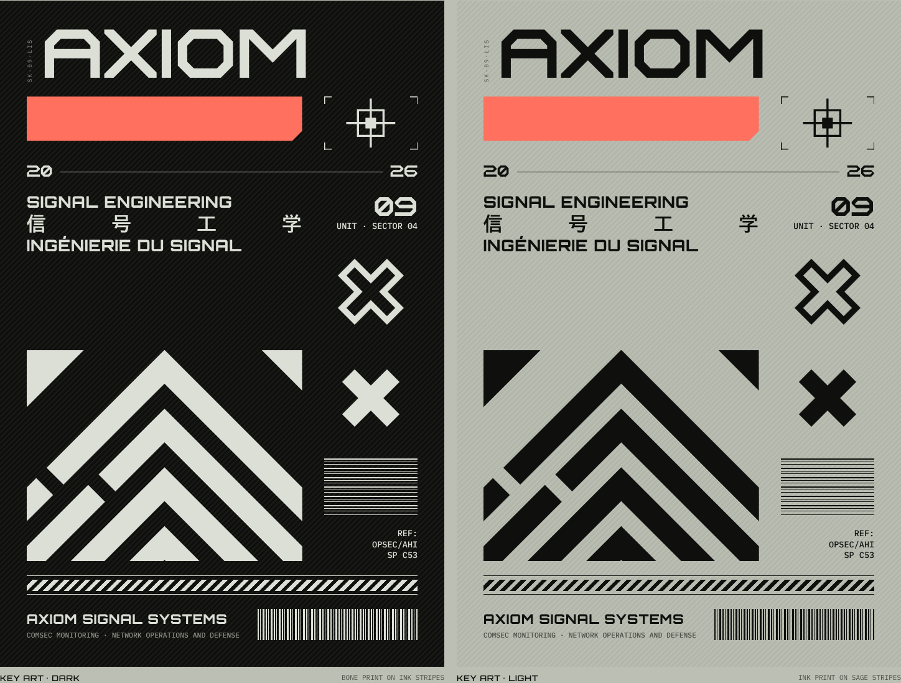
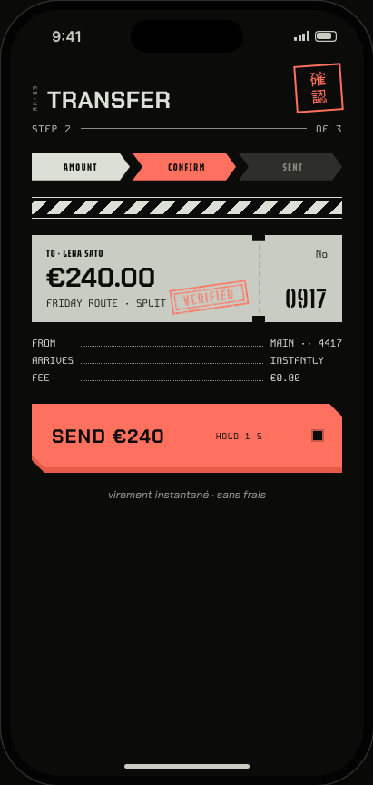
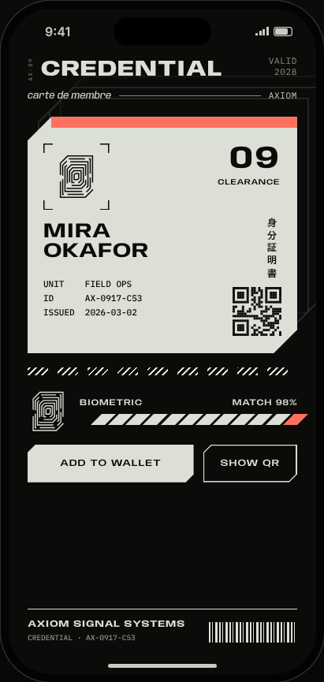

# Shingō 信号

*Shingō* is Japanese for "signal". It's an industrial interface system for iOS and the web. Interfaces are **printed** on a striped ground, like a two-ink screen print: wide hard type, one 45° diagonal, hazard stripes, chevrons, seven-segment readouts, stencil serials and mono telemetry, with one coral signal per screen. English leads, with Japanese and French as accents. Every screen ships in light and dark.



Open `dist/index.html` in a browser for the full gallery: key art, the shape alphabet, content motifs, backdrops, 26 iPhone screens, widgets, components, instruments, the poster series, motion studies and language rules. Use the switch in the corner to flip modes.

## Art direction

One spec. Everything in the repo follows it, and anything new must too.

**Color**
1. **Two inks.** Print on ground, nothing else. Solid shapes (keys, cards, badges, tickets, bars, plates) are print ink with the text knocked out. There is no third tone.
2. **One signal.** Coral is the only extra ink: one block or one primary action per screen, plus the latest or active state. Switches turn on in print. Coral used as text takes `--signal-text`, a deeper coral on sage so small type stays legible.

**Shape**

3. **One angle, one direction.** Every diagonal rises left to right at 45°. Corner cuts sit top-left and bottom-right at 6, 12 or 24 pt. Nothing is tilted, textured, shadowed or rounded; device chrome is the only exception.
4. **The alphabet.** Twelve primitives make everything: cut plate, tag, nested bar (a solid bar with a slot), slash, hazard, notch frame, hard X, diamond, chevrons, brackets, cell run and wedge.
5. **Content motifs.** Where a screen has a subject, its shape comes from that subject, drawn by the same rules: lock tumblers, postage stamp, DIP switches, wind barbs, packet flow, cut fingerprint, compass rose, level meters and security microtext.
6. **Icons.** One family on a 24-unit grid with 2-unit strokes, square caps and miter joins.

**Type**

7. **Wide, short, hard.** Anybody at three widths: display 40+ (extra-expanded 800), titles 28 (expanded 800) and inline 14 (expanded 700). Labels are wide caps. Body text is Anybody, telemetry IBM Plex Mono, serials Saira Stencil One and kanji BIZ UDGothic (Hiragino Sans on iOS). Big numbers are seven-segment readouts. Never condensed, never rounded.

**Layout**

8. **Two tiers.** Poster screens (launch, onboarding, lock screen, empty state, relay city, live activity) compose freely. Every other screen follows the grammar: masthead (micro-code, title, one tag, span rule) → one hero → divider → body → imprint footer (rule, wide-caps line, mono reference, barcode).
9. **Dividers by kind.** Hazard for system and safety screens, a tick ruler for data, a slash run for money and content.
10. **One backdrop per screen.** A tonal composition behind the content, chosen by subject: tunnel, slash field, terraces, plate stacks, airmail edges, diamond walk, X lattice, spectrum floor, notch, wedge, editorial columns, edge rulers, circuit traces, tiers, signal decay, relays.

**Imagery and motion**

11. **No pictorial scenes.** There is no photography and no illustrated or generated cities. Imagery comes from the shape system itself: backdrops, motifs and diagrams such as the relay network.
12. **Stepped motion.** Never eased, turning only in 45° steps. The one exception is tickers, which scroll continuously so they stay readable. Everything stays still when reduced motion is on.
13. **Live behaviour.** The interface behaves like a machine:
    - Titles resolve from glyph noise when they appear. Each character locks in at its own random moment, the flicker is irregular, and every title takes a slightly different time.
    - Seven-segment readouts re-render in place: timers count, counters climb, coordinates drift.
    - Views change behind a hazard band that crosses on the diagonal in eight steps.
    - A HUD reticle snaps coral brackets and a callout to data under the pointer (on iOS, press and hold).
    - Tickers scroll smoothly.

    On iOS each shape has a feel: a hard tick for switches and tabs, a double tick for keycaps, a heavy throw for the rocker, rising steps for cell meters, an error pattern for alerts and a success pattern for sealed. Web: `web/shingo-live.js`. iOS: `SGLive.swift` (`SGHaptics`, `SGScrambleText`, `SGLiveCountdown`, `.sgHazardWipe`, `.sgHUD`).

**Language**

14. **English runs the interface.** Japanese (a vertical tag or a seal) and French (the span rule or fine print) appear at most once each per screen. All three stack only once per app, on the lock screen.

| dashboard | interval timer | transfer | device |
|---|---|---|---|
|  |  |  |  |


## Light and dark

| | ground (striped) | print | plates | signal |
|---|---|---|---|---|
| **Dark** | ink `#0b0b0a` | bone `#dcdfd5` | bone, text knocked out | coral `#ff715e` (text `#ff715e`) |
| **Light** | sage `#bcbfb4` | ink `#0f100d` | ink, text knocked out | coral `#ff715e` (text `#8f2b1c`) |

Use role tokens, never raw hex. Things printed on the ground use `--ground-*`: `--ground-hi` is the print and `--ground-dim` is secondary print. Things on plates use `--sage-*` and `--ink`. Force a mode on any web subtree with `.mode-light` or `.mode-dark`. On iOS, every `SG` colour is dynamic and follows the system appearance or `.preferredColorScheme`.

| dark | light |
|---|---|
|  |  |
|  |  |

## What's here

```
tokens/tokens.json            colours (both modes), type, geometry, screen grammar, rules
tokens/lexicon.json           EN / 日本語 / FR phrase list with readings
web/shingo.css                tokens + components + screen grammar (.u-*)
web/shingo-live.js            live layer: scramble, live readouts, hazard wipe, HUD reticle
web/gallery.src.html          gallery source
web/partials/languages.html   the language section
tools/screens.py              regenerates the gallery screens from the grammar
tools/build.py                glyphs, motifs, backdrops, key art, posters; builds dist/
tools/screenshot.js           renders every screen in both modes (preinstalled Playwright)
dist/index.html               the built, self-contained gallery
assets/svg/*.svg              glyphs and icons (multi-colour ones as -dark/-light pairs)
ios/                          Swift package "ShingoKit" (iOS 17+), all colours dynamic
  Sources/ShingoKit/SGTheme.swift       SG colour tokens, SGFont, font registration
  Sources/ShingoKit/SGShapes.swift      SGHardX, DiamondMark, ChamferRect, TagCut, Brackets, UnitPolygon, SignalBars
  Sources/ShingoKit/SGTextures.swift    StripeField, Barcode, Spectrum, Scope
  Sources/ShingoKit/SGComponents.swift  SGBar, SGButtonStyle, SGToggleStyle, SGSegmented, SGChip, SGSlot, SGGroupLabel, SGTabBar
  Sources/ShingoKit/SGBackdrop.swift     SGBackdrop: eleven of the backdrop compositions
  Sources/ShingoKit/SGLive.swift        SGHaptics, SGScrambleText, SGLiveCountdown, sgHazardWipe transition, sgHUD readout
  Sources/ShingoKit/SGScreen.swift      SGUtilityScreen, SGCode: the screen grammar
  Sources/ShingoKit/SGInstruments.swift  SGSegDisplay, SGCellMeter, SGRuler, SGSteps, SGIndexTabs, SGCaution, SGStamp, SGTicket, SGKeycapStyle, SGRockerStyle, SGDataPlate, SGSpecRow, SGMatrixCode, .printMarks(), SGColorBar, SGTicker, SGBootLog, SGLamps, SGBlueprint, SGCallout, SGWave
  Sources/ShingoKit/SGLanguage.swift    VerticalText, Hanko, HazardBar, ChevronStack, YearSpan, ManifestoExample
  Sources/ShingoKit/Examples/           LaunchExample, DashboardExample, IntervalExample with light/dark #Previews
  Sources/ShingoKit/Resources/Fonts/    Anybody (3 widths + italic), Saira Stencil One, IBM Plex Mono (SIL OFL)
docs/                         screenshots of every screen in docs/dark and docs/light
```

## Build the gallery

```bash
python3 tools/screens.py
```

```bash
python3 tools/build.py
```

```bash
node tools/screenshot.js docs
```

## Use in an iOS app

1. In Xcode, go to File › Add Package Dependencies › Add Local… and pick the `ios/` folder.
2. Register the fonts once at launch:
   ```swift
   import ShingoKit
   @main struct MyApp: App {
       init() { SGFont.register() }
       var body: some Scene { WindowGroup { DashboardExample() } }
   }
   ```
3. Build screens on the grammar:
   ```swift
   SGUtilityScreen("Protected", span: (Text("since 08:14"), Text("lis-04")), tag: .japanese("保護中")) {
       SGBar(height: 100, bleed: .leading, progress: 0.82).frame(width: 270)
   } content: {
       Toggle("Kill switch", isOn: $on).toggleStyle(SGToggleStyle())
       Button("Disconnect") {}.buttonStyle(SGButtonStyle(.print))
   }
   ```
4. For static art, drag `assets/svg/*.svg` into an asset catalog and tick **Preserve Vector Data**. Single-colour glyphs render as template images, so tint them in code. For multi-colour ones (`scope`), set Appearances to Any/Dark and drop the `-light` file into Any and the `-dark` file into Dark.

> The Swift sources were written against the iOS 17 SwiftUI API but have **not been compiled yet**. The build environment had no Swift toolchain. Expect a few small fixes on the first Xcode build.

## Web → SwiftUI map

| Web | SwiftUI | Notes |
|---|---|---|
| `.tex`, `.facet` | `StripeField(facets:)` | 45° stripes, 6 pt period |
| `.u`, `.u-hd`, `.u-hero`, `.hazard`, `.u-body` | `SGUtilityScreen` | the screen grammar |
| `.bar` (+ `--bleed-r`) | `SGBar(height:bleed:progress:)` | band 16%, cut 42% of height |
| `#g-x-line` / `#g-x-solid` | `SGHardX()` stroke / fill | square-cut ends |
| `#g-mark` | `DiamondMark()` with `eoFill` | |
| `.chamfer`, `.cut` | `.chamferFrame()`, `ChamferRect` | cuts 6 / 12 / 24 |
| `.brackets` | `.brackets()`, `Brackets` | HUD corners |
| `.slab-cut` | `TagCut` | the coral tag slab |
| `.hazard` | `HazardBar` | |
| `.btn--*` | `SGButtonStyle(.print/.signal/.plate/.ink/.ghost)` | 48 pt, cut 10 |
| `.tgl` | `SGToggleStyle()` | |
| `.seg` | `SGSegmented` | |
| `.slot`, `.yearspan`, `.barcode` | `SGSlot`, `YearSpan`, `Barcode` | |
| `#g-spectrum`, `#g-scope` | `Spectrum`, `Scope` | |
| `seg7()`, `.cells`, `.ruler` | `SGSegDisplay`, `SGCellMeter`, `SGRuler` | readouts and levels |
| `.steps`, `.itabs`, `.caution`, `.stamp` | `SGSteps`, `SGIndexTabs`, `SGCaution`, `SGStamp` | |
| `.ticket`, `.keycap`, `.rocker`, `.dataplate` | `SGTicket`, `SGKeycapStyle`, `SGRockerStyle`, `SGDataPlate` | |
| `.marks`, `.colorbar`, `.ticker`, `.bootlog`, `.lamps` | `.printMarks()`, `SGColorBar`, `SGTicker`, `SGBootLog`, `SGLamps` | |
| `.callout`, `.blueprint`, `#g-wave`, `#g-matrix` | `SGCallout`, `SGBlueprint`, `SGWave`, `SGMatrixCode` | |

## Three languages

- **English** runs the interface: every action, label and number.
- **日本語** adds texture: vertical captions (`.sg-jp-v` / `VerticalText`), hanko seals (`.hanko` / `Hanko`) and display kanji. At most one per screen, and never the only label on a control.
- **Français** is the aside: italic notes in the span rule, dates, pull quotes and fine print (`.sg-fr` / `.sgFR()`). At most one per screen.

Every phrase, with its Japanese reading, is in `tokens/lexicon.json`. These are drafts: have native speakers check them before release.

## Origins

Shingō started from two references: a sage and coral poster (palette, striped ground, layered forms, right-aligned telemetry) and a trilingual technical print (wide industrial type, hazard bars, chevrons, barcodes, three languages). Later references added field-operations print (status matrices, redaction, ID plates) and a construction-guide poster (an exploded X, guides, city data over a photo). Earlier rounded forms from the first poster have been retired.

## SwiftUI coverage

ShingoKit covers the tokens, type, alphabet shapes, components, instruments, icons, the screen grammar and eleven backdrops. The newer pieces are web-only so far: the motifs, six of the backdrops, the ops furniture, constructed type, the relay network diagram, posters and motion. The Swift code hasn't been compiled yet.

## Fonts

Anybody, Saira Stencil One and IBM Plex Mono are licensed under the SIL Open Font License 1.1. You may bundle them in an app. Japanese uses Hiragino Sans, which ships with iOS, and BIZ UDGothic on the web. BIZ UDGothic isn't bundled because it's 4 MB.
